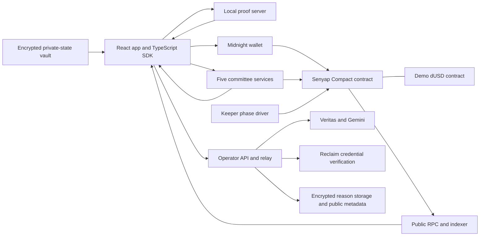

# Senyap

Senyap is a private market for insider recommendations on Midnight. Ecosystem
grant and business-development teams discover promising builders. Builders assess
which ecosystems support their teams. Scouts back an option with refundable
stakes and reasons. Buyers pay for aggregate support, and rewards follow outcomes.

The first use case is two-sided builder sourcing. The mechanism uses buyer-funded
rewards rather than transferring losing scouts' stakes to winners. Proven hoaxes
have a separate dispute and penalty process. All dUSD in this prototype is a
synthetic test token.

## What runs today

**The 52-circuit Senyap contract is deployed on Midnight Preprod.** A complete
fixed-price Side B market reached settlement, with five hit proofs and five
claims. The recorded browser demo also includes a personal scout stake on market
#6 and a purchase and signal opening by the project owner on market #7.

| Evidence | Scope |
| --- | --- |
| [157 indexed contract actions](docs/evidence/PREPROD-EVIDENCE.md) | Snapshot exported on 19 October 2026 at 03.41 UTC, not adoption metrics |
| [Market #3 journal](docs/evidence/F5-preprod-market-3-journal.json) | Complete Preprod Side B cycle, synthetic scouts and buyer |
| [Deployment journal](docs/evidence/P9.7-preprod-deploy-journal.json) | All 52 verifiers installed, maintenance handoff, operator and committee stakes |
| [Latest implementation CI](https://github.com/scientivan/senyap/actions/runs/39196182087) | Commit `1e798da`, compile, typechecks, 66 test files and build passed |
| [Focused QA verification](docs/evidence/demo-video-qa-review-2026-10-19.json) | 44 tests across 11 files, including rejection and recovery paths |
| [Local A/B cycle](docs/evidence/local-product-cycle-fresh-k16-r10-journal.json) | Earlier 42-circuit version, 84 finalized actions and exact fund conservation |
| [Local 52-circuit short cycle](docs/evidence/local-product-cycle-short-s2-journal.json) | 67 transactions, public-intent listing/opt-out, leaked-share seizure, cancelled market and refunds |

Live public state and synthetic participants are separate facts. The application
reads actual Preprod contract state. Most demo actors are synthetic, and **one
person controls all operator and committee seats**. No independent customers,
pilots, demand validation, security audit or production readiness are claimed.

## Submission materials

- [Product demo on YouTube](https://youtu.be/UV4MjUZe6lI).
- [Slide deck PDF on Google Drive](https://drive.google.com/file/d/1A2Qk5a0Xnbt_T2x5hawpUGyL_EhVNDDd/view?usp=sharing).
  The 18-slide deck uses
  the product design system, static explanatory diagrams and original purchase UI.
  The illustrated revision removes presentation buttons and explanatory card grids.
- [Demo script and scene guide](docs/submission/demo-video-script-v2-5min.md).
- [Presentation source](docs/submission/senyap-deck.html).
- [Wave 2 progress](docs/submission/wave-2-progress-draft.md).
- [Inspectable transaction receipts](docs/evidence/PREPROD-EVIDENCE.md).
- [Discord community post](https://discord.com/channels/1165826384975908924/1536921313598242847/1561660624428072971)
  and [screenshot evidence](docs/evidence/community-post-discord-2026-10-19.png),
  shared by the owner in Midnight Network's `#akindo-buildathon`.

The video uses separate examples from markets #6, #7 and #3. It does not present
these recordings as one continuous market. Additional auction, jury, subsidy and
reputation paths are identified as local test evidence.

## Product flow

1. Operators admit eligible scouts and buyers using three staked approvals from
   five registered operator keys.
2. A scout proves membership, backs a numbered option with demo dUSD and submits
   a reason. The public ledger stores commitments, nullifiers and encrypted tally
   updates rather than the individual option opening.
3. At least five scouts are required for a market to proceed. A committee
   publishes a strength histogram after closing, without public per-option totals.
4. A buyer purchases an option and requests three valid committee shares. DLEQ
   proofs check the shares. The purchased aggregate opens in the buyer's client.
5. The buyer or operator reports an outcome. Challenge and jury rules gate
   settlement. Qualifying scouts prove hits without opening misses and claim
   refundable principal plus their share of buyer-funded rewards.

Side A adds sealed ecosystem auctions and builder registration/public-intent
listings with opt-out. Side B uses fixed-price access and can receive a bounded
subsidy from Side A revenue. These paths have different evidence scopes, shown
above and in the linked tests.

## Architecture and Midnight integration



| Component | Responsibility |
| --- | --- |
| `apps/web` | Vite, React and TypeScript, role-specific task queues, wallet connection, encrypted vault and live contract views |
| `contracts/senyap.compact` | Groups, markets, commitments/nullifiers, encrypted tally, access, auctions, disputes, settlement and reputation |
| `contracts/dusd.compact` | Separate unshielded synthetic token |
| `packages/sdk` | Witnesses, deployment-bound read models, action preparation, paid signal opening and durable transaction reconciliation |
| `packages/crypto` | Additive ElGamal on JubJub, joint Shamir key generation, DLEQ-verified threshold decryption and encrypted buyer channels |
| `apps/operator` | Credential verification, hash-bound metadata, Veritas screening, encrypted reason storage and vault sync |
| `apps/committee` | Ledger-authorized buyer shares and threshold approvals, five local processes in this demo |
| `services/keeper` | Phase planning and deadline transitions, with a daemon entry point in `scripts/keeper-daemon.ts` |

Individual choices, salts, signing keys and receiving keys are stored in encrypted
private state. The public ledger holds commitments, one-use nullifiers, encrypted
aggregate values, visible stake accounting and approved results. A shared group
registry avoids publishing the selected scout group in Side B stake operations.
Buyer channels use X25519, HKDF and AES-GCM. Joint key generation uses
Feldman-verified Shamir shares. All shares were generated on one machine for the
demo, so this is not independent distributed operation.

Heavy browser transactions use a **local proof server**. The wallet balances,
signs and submits. A private witness reaches the prover. The operator and model
also process readable reasons for screening. These are explicit trust boundaries,
not claims that every private input stays exclusively inside a browser.

## Preprod deployment

| Item | Value |
| --- | --- |
| Network | Midnight Preprod |
| Senyap, 52 circuits | `a79019329f23d638ea7c690bf4fc8c9da6e60b6f7b3951cbf35ead11b8267ff9` |
| Demo dUSD contract | `e5ac20e387eb75b7357f19a309e8826e2849f60e1d63208d4514a8f3d716681e` |
| Installed verifiers | 52 of 52, staged deployment |
| Stakes in deployment journal | Operator seats 0–2 and committee seats 0–4, 500 dUSD each |

The earlier 42-circuit Preprod deployment remains a historical checkpoint. It is
not the contract used by the current recorded markets.

### Indexed transaction evidence

<!-- preprod-evidence:start -->
**157 finalized calls on the Preprod contract** (deploy 1, maintenance update 7, stakeOperator 3, stakeCommittee 5, voteOperatorAction 69, createSideBMarket 7, configureScoutGroup 2, admitScout 11, stake 25, admitBuyer 2, close 3, postPreview 9, buyFlat 2, recordOutcome 1, proveHit 5, claim 5). Full list with hashes: [docs/evidence/PREPROD-EVIDENCE.md](docs/evidence/PREPROD-EVIDENCE.md).

| Step | First transaction hash | Block |
| --- | --- | --- |
| deploy | `661a3c641a84851498fa49540231da9f31b4e53c8e88be33c96e4fa4b3f625b2` | 3032137 |
| createSideBMarket | `54451fd4089869b017c9d47df3fc0fdcab5c7afbe2976165564c692b83f3f032` | 3033035 |
| stake | `b7cdea635701d2a0b7d90e7e68003e053b757d0e29a1e272f44ddeb611fa550f` | 3034325 |
| postPreview | `d246ad2a3ccd541ba59e3f88be2b149e290a81d315ce905ab73e012fc0ce218f` | 3037466 |
| buyFlat | `af89b18c43a93a17f21e61662d2bc14aa012a675b21134478595e6554c2cc95e` | 3037495 |
| recordOutcome | `e38d5b1a0719d883d51b79df6a199b936df5ed264a4ffda9aef42a55c339bcb4` | 3037504 |
| proveHit | `10f50a79fd530e2b272ed13d92041ef0da029b516745fc57d3a0f1a19f7e485b` | 3037580 |
| claim | `7a4bfbee6c27585dac8c162934a285aa5c618ea00225732cd3a972db801e09ce` | 3037876 |
<!-- preprod-evidence:end -->

## Run locally

Prerequisites are Node.js 24.x, pnpm 10.18.3 and an installed Compact CLI. Pin the
compiler to **0.31.1**. The repository uses compact-runtime 0.16.0, Midnight.js
4.1.1 and proof server 8.1.3. Generated contract code, proving keys and public
frontend assets are excluded from Git and must be recreated after cloning.

```sh
pnpm install --frozen-lockfile
compact update 0.31.1
pnpm contracts:compile:proofs --filter senyap.compact
pnpm contracts:compile --filter dusd.compact
node scripts/prepare-product-assets.mjs
pnpm dev
```

Key generation can take several minutes. Do not run the full test suite at the
same time. A simulator-only compile can clear generated keys for its matched
contracts, so regenerate Senyap keys before preparing its public proving assets.
The preparation script verifies their source hash against the evidence manifest
and copies only public artifacts and deployment metadata.

Open <http://127.0.0.1:5174/> for the landing page or
<http://127.0.0.1:5174/app> for markets. Public market reads use the Midnight
Preprod RPC without a wallet or a Blockfrost token. Published questions and option
labels are checked against their onchain commitments. Missing or invalid metadata
is not replaced with fabricated market data.

### Transaction and service configuration

Copy the checked-in public deployment configuration when enabling the wallet
workspace.

```sh
cp apps/web/.env.preprod.example apps/web/.env.local
```

The example binds the recorded Preprod contract to local operator and committee
endpoints. It does not start those services or provide any private keys. The
operator API, five committee services, proof server and operator relay used by
the recording run on the author's machine. A fresh clone cannot impersonate its
admitted scouts or decrypt signals purchased by another vault.

The development proxy is enabled only when both `SENYAP_PREPROD_PROXY=1` and a
server-side `BLOCKFROST_PROJECT_ID_PREPROD` are present in the process environment.
After configuring those privately, run the frontend with the proxy enabled.

```sh
SENYAP_PREPROD_PROXY=1 pnpm dev
```

The proxy adds the Blockfrost credential server-side for indexer history and the
configured wallet RPC. It also forwards `/__proof` to the local proof server and
`/__relay` to the operator relay. Do not put a Blockfrost token, seed or committee
share in a `VITE_*` variable or browser bundle.

[.env.example](.env.example) lists service variable names without credentials.
[apps/web/.env.preprod.example](apps/web/.env.preprod.example) contains public
configuration only. Running the author-controlled services requires separately
provisioned keys and credentials. This README does not grant access to those
private keys or make historical market windows available for new transactions.

## Judge walkthrough

1. Start the frontend and inspect the landing explanation of who sees each value.
2. Browse `/app` without a wallet. Open market #3 and inspect its settled phase,
   public accounting and recorded activity. Use the committed metadata labels.
3. Match the recorded `buyFlat`, `recordOutcome`, five `proveHit` and five `claim`
   actions to the [market #3 journal](docs/evidence/F5-preprod-market-3-journal.json).
4. Inspect `/operator/registry` for seats, funded stakes and approval rules. Do not
   interpret five registered seats as five independent operators.
5. With an operational service configuration and a Preprod wallet, connect and
   unlock a vault. Scout tasks use `/app/act?market=ID`, owned positions use
   `/app/activity`, and purchased signals use `/app/purchases`. The old
   `/app/preprod` route redirects into the current action flow.
6. Only an admitted account with its own saved private state can take eligible
   actions. If a recorded market's clock has expired, inspect its receipts and
   the video instead of treating it as an always-open faucet demonstration.

Vault exports and sync are encrypted. Losing the password cannot be repaired by
the operator. Pending or uncertain transactions stay blocked until their recorded
receipt is reconciled, with no automatic resubmission.

## QA and reproducibility

```sh
pnpm contracts:compile
pnpm typecheck
pnpm test
pnpm --filter @senyap/web typecheck
pnpm build
```

Run this simulator/CI sequence before regenerating the public proving assets when
both are needed. CI compilation uses `--skip-zk`. A green run is not proof that
all 52 circuits were independently proved or cryptographically audited.

Tests cover valid flows and rejection/recovery behavior, including unpaid access,
forged shares, invalid membership, wrong payout witnesses, low-participation
refunds, disputed outcomes, credential reuse, subsidy conservation, unavailable
reason screening and uncertain wallet responses. Five-node HTTP tests tolerate
two unavailable committee nodes and preserve purchased access after recovery.
See [focused verification](docs/evidence/demo-video-qa-review-2026-10-19.json).

Historical proof files retain their own source hashes. In particular, the local
S11 stake/renewal proof uses source `4f039fa6…`, the full r10 A/B cycle uses
`4f1b3390…`, and the 52-circuit short local cycle uses `edb4251f…`. Their evidence
must not be silently attributed to a different contract version. The short cycle
ends in cancellation and refund, not a second complete settled A/B cycle.

## Trust model and current limits

- **Centralized today.** Dien holds every operator key and committee share and
  runs all five committee processes and the relay. The onchain threshold rules
  do not protect users from that single controller. Independent seat holders
  must create their own keys and shares before a corresponding redeployment.
- **Visible funding.** dUSD stakes are unshielded. Amounts and funding wallets
  remain public. Timing and small-cohort correlations are not eliminated.
- **Committee access.** Three colluding committee members can reconstruct totals
  and inspect auction bids. The public preview is a histogram, but its computation
  still trusts the committee. DLEQ checks share consistency, not truth of outcomes.
- **Reason screening.** The operator and Gemini see readable reasons. Redaction
  and AI/duplication indicators are uncertain. A failed screen withholds raw text,
  and model scores cannot authorize a financial penalty.
- **Penalty gap.** Invalid shares are rejected offchain, but the proposed 100%
  wrong-share slash is not enforced onchain. A leaked key share can be proven,
  while collusion leaking only a final total cannot be proven that way.
- **Credentials.** The live Reclaim proof establishes a logged-in GitHub account
  with the configured provider. It does not establish username, contribution
  count or complete resistance to duplicate accounts.
- **Demo actors.** Market #3 uses synthetic scouts and buyer identities. The
  owner also made a personal browser stake and purchase. These actions do not
  establish independent customers or willingness to pay. All tokens are synthetic.
- **Operational findings.** The operator vote timestamp window is about 60 seconds
  and can fail with slow wallet balancing. Market #5's 15-minute outcome window
  expired before purchase. Later plans use longer windows. The sealed operator
  window needs a contract redeployment to change.
- **Hosting.** The recording's offchain services are local. A public RPC read
  does not make the operator, committee, proof server or admission service public.
- **Validation.** No independent security audit, customer pilot or measured
  recommendation quality is claimed. Outcome evidence initially comes from a
  buyer/operator report and can be challenged under the contract rules.

## Economics and next validation

Buyer payments allocate 85% to qualifying scout rewards and 15% to the platform.
Up to five percentage points of Side A buyer revenue can support Side B rewards,
without taking a second platform cut from the subsidy. Refundable principal is
accounted separately from these rewards.

The proposed pilot recruits opt-in builders, ecosystem grant/BD buyers and
independent scouts. It tests willingness to pay, whether the signals change a
real decision, outcome quality and repeat purchases. This is a plan, not a
completed pilot or commitment from a partner.

## Prior work and license

Bisik was built on Solana for the Colosseum Crypto World's Fair and submitted on
13 October 2026. Its market idea carries over. Its Solana, Arcium and Semaphore
code is not part of this repository. Senyap's Midnight contracts, cryptography,
services, SDK and interface were written for Wave 2. The official bboard fixture
retains its upstream Apache-2.0 attribution.

Senyap source is licensed under [Apache-2.0](LICENSE). Dependencies retain their
own licenses. [DESIGN.md](DESIGN.md) defines the product's visual system.
[docs/agents.md](docs/agents.md) contains public contributor rules.

Some design/specification notes are historical checkpoints. This README's status
summary and source-qualified receipts distinguish what was demonstrated on
Preprod from local tests, historical proofs and future production work.
