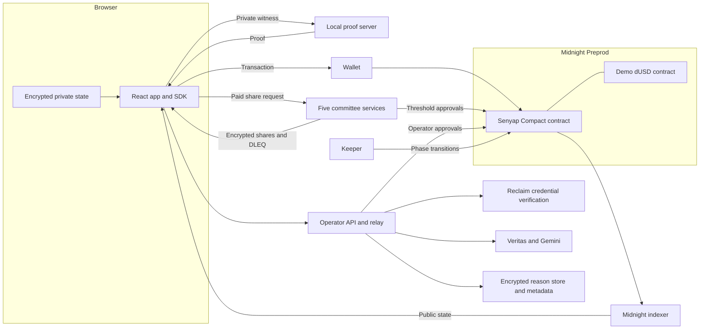

# Catatan revisi demo Senyap

Disusun 19 Oktober 2026 untuk [naskah 5 menit](demo-video-script-v2-5min.md). **[Inferensi]** Tujuan edit adalah membuat alasan produk, kontribusi Midnight dan kedalaman QA lebih mudah dinilai, sambil mempertahankan bukti alur produk yang sudah direkam.

**Pembaruan produksi** Dien telah menyetujui pelaksanaan revisi. Implementasi dan status hasil video dicatat di [handoff produksi](demo-video-v2-production.md). Bagian analisis di bawah mencatat kondisi saat naskah disusun.

## Hasil eksplorasi

**[Fakta]** Bahan diperiksa melalui `task-tracker.md` bagian 7b, SPEC, PRODUCT, README, kontrak, SDK, crypto, operator, committee, keeper, pengujian, journal Preprod, serta sumber Remotion. Beberapa paragraf README, PRODUCT dan SPEC masih memakai status historis. Klaim naskah diikat ke kode dan journal yang sesuai, dengan tracker terbaru sebagai konteks.

**[Fakta]** Pemeriksaan visual menggunakan contact sheet pada interval 12 detik untuk tiga file, bukan pemutaran penuh beserta penilaian audio.

| Bahan | Temuan | Implikasi edit |
| --- | --- | --- |
| `Pitch Video.mp4` | Referensi Bisik, 1920×1080, sekitar 178,645 detik. Memakai ilustrasi aktor, aliran dana, kartu mekanisme, narasi dan face cam | Ambil cara menyederhanakan ide, gunakan merek dan teknologi Senyap |
| `Product Demo Video.mp4` | Referensi demo Bisik di Solana, bukan hasil Senyap | Referensi pola rekaman dan callout saja |
| `video/remotion/out/senyap-demo-draft4.mp4` | Hasil Senyap, 1920×1080, 30 fps, sekitar 180,224 detik menurut ffprobe. Timeline 180 detik | Bahan utama alur website, belum memakai naskah baru |
| `video/remotion/src/timeline.ts` | 14 scene, memakai market #6 untuk stake, #7 untuk beli, #3 untuk settlement | Nyatakan perpindahan market di narasi dan label |
| `video/remotion/src/Demo.tsx` | Rekaman dibungkus card, role badge, caption, callout dan bingkai face cam | Tambahkan tipe scene ilustrasi pada tahap implementasi berikutnya |
| `video/remotion/srt.ts` | SRT saat ini dibentuk dari satu caption ringkas per scene | Subtitle final perlu mengikuti ucapan, terpisah dari headline visual |

**[Inferensi]** Versi awal kuat sebagai demonstrasi alur. Kekurangan utamanya adalah pembuka tanpa bukti masalah, penjelasan teknis yang hanya berupa nama komponen, serta QA yang hanya memperlihatkan CI. Revisi menghubungkan setiap mekanisme dengan keputusan atau kegagalan yang ditanganinya.

## Bukti masalah dan batas validasi

**[Fakta]** [Review Plurality Labs](https://forum.arbitrum.foundation/t/plurality-labs-milestone-1-review/20198), bagian Questbook Support Rounds, melaporkan pencarian proposal grant berkualitas sebagai risiko utama yang disampaikan Questbook. Ini merupakan laporan pelaku program, bukan wawancara pelanggan Senyap.

**[Fakta]** [Evaluasi ARDC oleh Castle Labs dan DefiLlama Research](https://forum.arbitrum.foundation/t/recommendations-for-improving-the-dao-s-grant-programs/28645), diterbitkan 7 Maret 2025, mencatat komunikasi yang terpencar, pelepasan dana yang kadang terlambat, serta beberapa kesalahan pencairan. Laporan tersebut juga mencatat keberhasilan program. Jangan menyimpulkan semua program atau ekosistem bermasalah.

**[Inferensi]** Dua sumber memberi dasar untuk masalah seleksi builder dan penilaian dukungan program. Keduanya tidak membuktikan anonimitas meningkatkan kualitas rekomendasi, scout mau berbagi, atau buyer mau membayar. Ketiganya menjadi hipotesis pilot.

Kartu sumber perlu memuat judul ringkas, penerbit, tahun, dan URL yang dapat dibaca atau diikuti dari deskripsi video. Gunakan parafrasa. Bila menampilkan screenshot artikel, sorot hanya bagian yang mendukung klaim.

Klaim penutupan MegaMafia pada referensi Bisik tidak dipindahkan ke Senyap. Bukti primer yang dipakai pada naskah baru sudah mendukung masalah tanpa membutuhkan klaim itu.

## Rubrik dan pilihan editorial

**[Fakta]** `task-tracker.md` bagian 2 dan `SPEC.md` bagian 12 menyimpan bobot Engineering 40%, QA/Product/UX masing-masing 15%, Communication 10%, Business 5%. Tracker juga menyebut rubrik Google Doc dengan pembobotan berbeda. Itu dua sumber, bukan satu bobot yang boleh dicampur.

Sumber asal tercatat sebagai [halaman AKINDO](https://app.akindo.io/wave-hacks/jaMZjqPOBsLXvjdG), [Official Rules PDF](https://drive.google.com/file/d/1YKXtsw5nghcEBEW0BFrLn-U34AfH_MF4/view), dan [rubrik Google Doc](https://docs.google.com/document/d/1-dDTqWa2CcfnSEvgXq83La2M8zAxi4jtVtKpMJRm3Oo/edit). Verifikasi web sesi ini tidak berhasil membaca isi lengkap rubrik dan aturan. Pembobotan di atas diatribusikan ke salinan lokal, bukan konfirmasi ulang aturan terkini. Durasi 5 menit adalah pilihan yang diizinkan Dien, bukan batas resmi yang telah diverifikasi.

**[Inferensi]** Engineering perlu memperlihatkan pembagian state, arus proof dan trust boundary. QA perlu memperlihatkan penolakan, pemulihan, lalu bukti jaringan. UX diperlihatkan sepanjang alur pengguna, bukan hanya lewat satu slide bertuliskan UX. Business cukup menjelaskan payer, alokasi pembayaran dan tes permintaan berikutnya.

## Inventaris engineering yang perlu disebut

**[Fakta]** Inventaris berikut bersumber dari berkas implementasi pada kolom terakhir. Lokasi scene adalah rancangan editorial. Komponen yang cukup disebut sebagai label tidak harus dibacakan seluruh detailnya.

| Komponen atau mekanisme | Yang harus dipahami juri | Scene | Bukti lokal |
| --- | --- | --- | --- |
| React, Vite, TypeScript | Antarmuka per peran | 04–09 | `apps/web/package.json`, `apps/web/src/app/` |
| SDK TypeScript dan Midnight.js | Menyiapkan witnesses, aksi dan pembacaan state | 09 | `packages/sdk/src/`, `apps/web/src/app/product-client.ts` |
| Encrypted private-state vault | Secret, salt, pilihan dan credential disimpan dengan scope network/account/deployment | 04 | `packages/sdk/src/private-state.ts`, `workspace.ts`, `client-state.ts` |
| Local proof server | Memproses witness untuk menghasilkan proof. Batas kepercayaan terpisah dari wallet | 04, 09, 16 | `apps/web/src/app/product-client.ts` baris 51–56 |
| Wallet connector | Wallet balance, sign dan submit, bukan penyimpanan seluruh state aplikasi | 04–05 | `apps/web/src/app/wallet-connector.ts`, `product-client.ts` |
| Indexer dan read model | Menampilkan state publik berjangkar pada deployment yang benar | 06, 09, 14 | `packages/sdk/src/read-model.ts`, `snapshot.ts`, `apps/web/src/app/data/live.ts` |
| Senyap Compact | 52 circuit pada deployment yang direkam | 09 | `contracts/senyap.compact`, `P9.7-preprod-deploy-journal.json` |
| Kontrak dUSD terpisah | Token demo unshielded. Nominal dan funding wallet terlihat | 05, 09, 16 | `contracts/dusd.compact` |
| Instalasi verifier bertahap | Menyesuaikan ukuran deployment dengan batas jaringan, seluruh verifier dipasang sebelum aksi produk | 09 sebagai label | `scripts/lib/staged-product-deployment.ts`, journal P9.7 |
| Keanggotaan Merkle, shared root registry | Membuktikan eligibility tanpa menaruh selected group, leaf, root privat pada public transcript | 05, 10 | `tests/contracts/group-privacy.test.ts`, `packages/sdk/src/group-trees.ts` |
| Nullifier dan commitment | Mencegah pemakaian ulang otorisasi dan mengikat pilihan tanpa mengumumkannya | 05–06 | `contracts/senyap.compact`, `tests/contracts/stake.test.ts` |
| ElGamal aditif pada JubJub | Tally dijumlahkan dalam keadaan terenkripsi | 10 | `packages/crypto/src/index.ts`, `tests/contracts/stake.test.ts` |
| Joint key generation dan threshold Shamir | Tiga dari lima share cukup untuk dekripsi | 10 | `packages/crypto/src/dkg.ts`, `tests/crypto-dkg.test.ts` |
| DLEQ dan buyer channel | Memverifikasi share, mengenkripsi delivery untuk receiving key buyer yang membeli | 07, 10 | `packages/crypto/src/buyer-share.ts`, `buyer-channel.ts`, `tests/contracts/paid-share.test.ts` |
| Operator API dan relay | Admisi, metadata, credential dan relay transaksi operator | 06, 09 | `apps/operator/src/`, `scripts/preprod-operator-api.ts`, `preprod-operator-relay.ts` |
| Reclaim zkTLS | Provider yang dipakai membuktikan akun GitHub login. Tidak membuktikan kontribusi atau username | 09 sebagai label | `docs/evidence/P6.1-reclaim-live-preprod.json`, `apps/operator/src/reclaim.ts` |
| Veritas, Gemini dan penyimpanan alasan | Screening duplikasi, flag AI, pemisahan klaim/opini, redaksi identitas. Output dan metadata alasan disimpan terenkripsi | 05, 09, 13 | `apps/operator/src/veritas.ts`, `gemini.ts`, `reason-repository.ts` |
| Metadata hash-bound dan SQLite | Teks pertanyaan/label offchain diverifikasi terhadap hash onchain, alasan disimpan dengan binding yang sesuai | 09 sebagai label | `market-metadata.ts`, `builder-metadata.ts`, `reason-repository.ts` di operator dan SDK |
| Operator 3-dari-5 dan stake | Memerlukan tiga key berbeda, belum tiga pengelola independen | 06, 16 | `contracts/senyap.compact`, README Trust model |
| Committee HTTP ×5 | Share delivery yang memeriksa paid access, preview dan keputusan threshold | 07, 09–10 | `apps/committee/src/`, `tests/contracts/committee-http.test.ts` |
| Keeper | Menggerakkan transisi fase dan tindak lanjut tenggat | 09, 11 | `services/keeper/`, `scripts/keeper-daemon.ts` |
| Registry builder | Registrasi sukarela, public-intent berbukti, opt-out dan consent | 11 sebagai label | `tests/contracts/builders.test.ts`, `decisions-d18.test.ts` |
| Lelang tertutup sisi A | Bid terenkripsi, escrow ceiling, alokasi dan refund | 11 | `tests/contracts/auction.test.ts`, `auction-crypto.test.ts` |
| Pembelian tetap sisi B dan subsidi | Pembelian per opsi, subsidi dari pendapatan A, tanpa potongan platform kedua pada subsidi | 07, 11, 15 | `tests/contracts/subsidy.test.ts`, `shared-report.test.ts` |
| Outcome, proveHit dan claim | Pelaporan outcome, pembuktian hit, pengembalian stake dan hadiah | 08 | `tests/contracts/settlement.test.ts`, journal market #3 |
| Default, pembatalan dan refund | Tenggat dan partisipasi yang tidak terpenuhi memiliki jalur penyelesaian | 11–12 | `tests/contracts/default.test.ts`, `cancellation.test.ts` |
| Jury dan accountability card | Commit-reveal, bond, resolusi hoax, threshold pembukaan kartu untuk pencabutan | 11 | `tests/contracts/disputes.test.ts`, `outcome-jury.test.ts`, `hoax-card-http.test.ts` |
| Reputasi privat | Hit credential mendukung renewal per epoch tanpa membuka posisi lama | 11 | `tests/contracts/reputation.test.ts` |
| Kontak atas consent | Penyerahan identitas hanya bila scout mengizinkan | 11 sebagai label | `packages/sdk/src/identity-reveal.ts`, `tests/contracts/identity-reveal.test.ts` |
| Journal dan reconciliation | Simpan ID sebelum submit, blokir pengiriman saat status ambigu, periksa receipt | 13 | `packages/sdk/src/operation.ts`, `tests/frontend/product-client.test.ts` |

**[Fakta]** `smart-match.ts` memakai pencocokan kata sederhana di browser. Jangan menyebutnya model AI yang berjalan lokal. Pilihan bernomor tetap dikonfirmasi pengguna. Veritas adalah komponen terpisah yang menggunakan model server.

**[Fakta]** Komentar modul `dkg.ts` menyebut Pedersen DKG tetapi juga menjelaskan Feldman-verified joint Shamir. Implementasi memakai komitmen koefisien `aG`. Naskah memilih istilah lebih tepat dan netral `joint key generation`. Transport terenkripsi antarpihak berada di luar modul, dan demo menjalankan semua share pada satu mesin. Jangan mengklaim DKG terdistribusi independen atau Pedersen hiding commitments sudah dibuktikan.

## Diagram arsitektur untuk scene 09

Diagram ini adalah rancangan untuk animator. Pada video, munculkan tiga kelompok secara bertahap. Beri batas visual `Local demo environment` yang meliputi layanan lokal.



Label public/private berlaku pada **nilai**, bukan seluruh mesin. Prover lokal memproses witness. Operator dan Gemini memproses alasan yang dapat terbaca. Komite threshold dapat merekonstruksi total. Wallet funding tetap terlihat karena token unshielded.

## QA yang bisa diperlihatkan

**[Fakta]** Pada sesi ini dijalankan ulang **44 tes pada 11 file**, seluruhnya lulus dalam **65,35 detik**, memakai konfigurasi repo yang ada. Ini subset relevan untuk naskah, bukan full suite baru, audit keamanan, uji beban atau proof semua circuit. Hasil mencakup warning sourcemap dan SQLite, serta stderr yang sengaja dipicu tes penolakan. Ringkasan tersimpan di [bukti review QA](../evidence/demo-video-qa-review-2026-10-19.json).

| Perilaku | Sumber tes | Cara menampilkannya |
| --- | --- | --- |
| Akses opsi yang belum dibeli ditolak | `tests/contracts/paid-share.test.ts` | Sorot assertion `not purchased`, lalu hasil PASS asli |
| Dua share tidak cukup, share palsu ditolak | `tests/contracts/paid-share.test.ts` | Ilustrasi 2/5 tertutup, 3/5 valid membuka, share berubah ditolak |
| Group, leaf dan root privat tidak muncul dalam public operations | `tests/contracts/group-privacy.test.ts` | Sorot pemeriksaan `publicTranscript`, jangan tampilkan witness |
| Kurang dari lima scout mengembalikan stake | `tests/contracts/cancellation.test.ts` | Tampilkan nama tes low-k dan dua kotak `Cancel` serta `Refund` |
| Witness payout yang dibesarkan ditolak | `tests/contracts/settlement.test.ts` | Perbesar nama tes penolakan inflated payout |
| Hoax, quorum gagal dan tie memiliki aturan bond berbeda | `tests/contracts/disputes.test.ts` | Cukup satu kartu `Dispute rules tested` pada scene 11 |
| Credential tidak boleh dipinjam atau dipakai ulang secara tidak sah | `tests/contracts/reputation.test.ts` | Label `Distinct owned credentials` pada scene 11 |
| Subsidi dan refund tetap mempertahankan akuntansi dana | `tests/contracts/subsidy.test.ts` | Detail pelengkap di repo, tidak perlu memenuhi layar |
| Status unknown tetap memblokir send dan tidak otomatis dikirim ulang | `tests/frontend/product-client.test.ts` | Ilustrasi status, nama tes no retry dan explicit check |
| ID transaksi wallet 66 hex diterima dengan validasi | `tests/frontend/tx-id.test.ts` | Bukti regresi bug nyata, cukup pada catatan produksi |
| Screening gagal tidak membocorkan raw reason | `tests/contracts/reasons.test.ts` | Sorot `withholds reasons on unavailable screening` |
| Layanan pulih tanpa pembelian ulang dan akses tetap | `tests/contracts/reasons.test.ts`, `committee-http.test.ts` | Ilustrasi retry. Tes HTTP juga menoleransi dua node komite unavailable |

Command reproduksi dari root Akindo, tanpa wallet atau pengiriman onchain.

```sh
rtk proxy pnpm exec vitest run tests/contracts/group-privacy.test.ts tests/contracts/paid-share.test.ts tests/contracts/settlement.test.ts tests/contracts/cancellation.test.ts tests/contracts/disputes.test.ts tests/contracts/reputation.test.ts tests/contracts/subsidy.test.ts tests/contracts/reasons.test.ts tests/contracts/committee-http.test.ts tests/frontend/product-client.test.ts tests/frontend/tx-id.test.ts
```

Untuk rekaman editor, jalankan hanya satu file dengan `--reporter=verbose`, kemudian rekam nama tes dan hasil sebenarnya. Jangan mengulang full suite hanya untuk mendapat animasi terminal. Ilustrasi QA diberi label `Local tests` atau `Illustration of tested behavior`, sedangkan footage Preprod diberi label `Preprod`.

**[Fakta]** [CI 39196182087](https://github.com/scientivan/senyap/actions/runs/39196182087) diperiksa melalui GitHub CLI dan berstatus completed/success pada commit `1e798daba9e999acbfca3e4e9a57a9ebab52ac9b`. Log menunjukkan 66 file tes lulus. Workflow menjalankan compile, typecheck root, test, typecheck web dan build. Compile CI memakai `--skip-zk`, sehingga jangan menyebutnya regenerasi proving keys atau proving seluruh 52 circuit.

## Bukti jaringan dan versi source

**[Fakta]** `docs/evidence/preprod-transactions.json` menyimpan snapshot 19 Oktober 2026 03.41 UTC dengan 157 indexed actions pada kontrak `a7901932…7ff9`. Di dalamnya ada 7 createSideBMarket, 25 stake, 2 buyFlat, 1 recordOutcome, 5 proveHit dan 5 claim. Ini bukan 157 pengguna, bukan 157 pembelian, serta bukan ukuran adopsi.

**[Fakta]** Journal market #3 pada deployment tersebut berstatus settled dan mendokumentasikan buyer serta scout sintetis. Pembelian browser Dien yang direkam memakai market #7. Stake pribadi yang direkam memakai market #6. Naskah menyebut pergantian ini secara eksplisit.

**[Fakta]** Journal r10 berstatus completed, konservasi `1240 = 1120 + 100 + 20`, tetapi source-nya `4f1b3390…`, yakni versi sebelum kontrak 52 circuit terbaru. Journal short-s1 untuk source lebih baru berhenti pada `Invalid listing timestamp`, bukan siklus penuh berhasil. Karena itu naskah tidak memakai klaim bahwa siklus lokal penuh r10 membuktikan semua fitur deployment terbaru.

**[Fakta]** Bukti proving S11 historis memakai source `4f039fa6…`. Gunakan sebagai riwayat proof lokal. Pemeriksaan transcript saat ini ditopang pula oleh tes simulator yang dijalankan ulang, tanpa menyamakannya dengan proving seluruh source terbaru.

## Koreksi klaim versi awal

| Klaim lama | Pengganti pada revisi | Alasan |
| --- | --- | --- |
| `Keys never leave the device` | `Encrypted local storage. Local proving.` | Local prover menerima witness untuk proof berat |
| `My browser proves` | `The proof checks` serta penjelasan prover | Pembentukan state di browser berbeda dari lokasi proving |
| `Only the scout sees the choice` | `Individual picks stay sealed on the public ledger` | Operator/model dapat menyimpulkan pilihan dari alasan |
| `Decrypted only for the payer` | `Purchased total opens for the buyer` dan disclosure komite | Threshold committee juga dapat merekonstruksi total |
| `No demo data` | `Live Preprod state · synthetic demo participants` | Pembacaan jaringan asli tidak menjadikan aktornya pengguna independen |
| `Simulator tests for every rule` | Nama skenario konkret dan scope tes | Tidak ada dasar untuk mengklaim coverage lengkap setiap aturan |
| `200+ tests` | Hasil CI dan subset yang dapat diperiksa | Hindari angka estimasi dan klaim coverage dari jumlah tes |
| `A full local cycle before Preprod` | Bukti market #3 pada deployment terbaru | Siklus lokal penuh berasal dari versi kontrak sebelumnya |
| `Anonymous payouts` | `Accountable outcomes` | Funding wallet dan penerima dUSD publik. Klaim anonimitas jaringan terlalu luas |
| `52 circuits` sebagai total semua kontrak | `52 Senyap circuits` serta `Separate dUSD contract` | Ada dua kontrak dengan fungsi berbeda |

**[Fakta]** Batas tambahan yang tetap perlu tersedia dalam dokumentasi submisi adalah satu orang menguasai semua seat, provider Reclaim hanya membuktikan akun login, operator/model membaca alasan, outcome awal dilaporkan buyer/operator, belum ada audit independen, serta penalti wrong-share 100% belum ditegakkan onchain. Bukti DLEQ menolak share salah di klien, bukan bukti kontrak sudah men-slash anggota tersebut. Batas vote operator 60 detik juga merupakan temuan operasional yang belum diperbaiki pada deployment ini.

## Arahan visual dan pemakaian rekaman

Gunakan pola ilustrasi Pitch Video berupa aktor sederhana, aliran nilai, dan satu ide per frame. Pakai SF Pro dan palet Senyap `#2A1B1B`, `#A50C22`, `#C1272D`, `#AE9970`, putih. Hindari menyalin logo Bisik, Arcium atau Semaphore sebagai arsitektur Senyap.

| Scene baru | Bahan yang dipakai kembali | Tambahan |
| --- | --- | --- |
| 01 | `scene1-2-landing.mp4` | Label dua pengguna |
| 02–03 | Tidak perlu rekaman baru | Kartu sumber dan alur mekanisme |
| 04 | `scene3-wallet-vault.mp4` | Batas vault, prover dan wallet |
| 05 | `scene4-stake.mp4` | Label market #6 dan demo token |
| 06 | `scene5-public-view.mp4`, `scene6-operators.mp4` | Pemisahan data publik dan privat |
| 07 | `scene7-8-close-buy.mp4`, `scene8-purchases.mp4` | Label market #7 |
| 08 | `scene9-settled.mp4` | Label market #3 dan peserta sintetis |
| 09–11 | `scene10a-engineering.mp4` opsional sebagai insert singkat | Diagram sistem, dekripsi dan siklus |
| 12–13 | Hasil tes asli yang diperbesar | Ilustrasi serangan dan recovery |
| 14 | `scene10b-qa-ci.mp4`, `scene11-evidence.mp4` | Crop bukti yang sesuai dan timestamp snapshot |
| 15–17 | Ilustrasi baru | Pembayaran, pilot, disclosure dan penutup |

Semua clip sumber ada di `video/remotion/public/`, dengan rekaman mentah di `video/raw/`. Periksa kembali titik awal dan durasi setelah voiceover tersedia. Jangan meregangkan rekaman 9 detik ke 20 detik hanya untuk memenuhi slot. Sisipkan ilustrasi, crop detail atau freeze pada hasil yang benar-benar ada. Waktu tunggu yang dipotong diberi label.

Pada ilustrasi, satu fokus utama dan maksimal dua kelompok label terlihat bersamaan. Diagram arsitektur lengkap hanya panduan animator, bukan satu slide padat untuk dibaca selama 22 detik. Tahan setiap istilah teknis selama bagian narasi terkait. Ukuran label minimal sekitar 28–32 px pada 1080p dan caption 32–38 px, lalu uji pada preview lebar 960 px.

Face cam lama berukuran 300×270 pada x1560, dengan y150 atau y760. Tentukan posisi per scene sebelum menaruh diagram. Untuk slide baru, area utama diagram bisa di x80–1460 agar tidak bertabrakan dengan wajah. Caption tidak menutupi hasil transaksi, pilihan yang dibeli, atau tombol status yang dibahas.

## Handoff produksi

1. Rekam pembacaan narasi. Naskah memuat 632 kata dengan rata-rata 126,4 kata per menit pada slot 5 menit. Perkiraan per scene sekitar 105–148 kata per menit, belum mengukur pelafalan Dien dan jeda.
2. Cocokkan timing dengan suara aktual. Scene 14–16 lebih rapat sehingga dapat memakai jeda scene penutup bila diperlukan. Jangan mempercepat istilah teknis agar sekadar masuk slot.
3. Buat layout ilustrasi dan preview frame sebelum mengubah komposisi video. Dokumen ini merupakan brief yang dapat ditinjau, bukan persetujuan visual akhir atau implementasi Remotion.
4. Tambahkan tipe ilustrasi pada komposisi Remotion dan atur ulang timeline. Keep output versi baru terpisah agar draft 4 tetap tersedia.
5. Buat subtitle dari narasi yang benar-benar direkam. Pecah menjadi cue singkat yang mengikuti ucapan. Generator SRT lama dari `scene.caption` tidak memadai untuk subtitle ucapan lengkap.
6. Render preview, periksa transisi, keterbacaan URL, face cam, caption, label sintetis dan pergantian market.
7. Jika memakai render per 1350 frame seperti pipeline lama, 5 menit pada 30 fps berjumlah 9000 frame. Gunakan rentang 0–1349, 1350–2699, 2700–4049, 4050–5399, 5400–6749, 6750–8099, 8100–8999. Gabungkan dengan parameter encode konsisten dan periksa sambungan audio setelah voiceover ditambahkan.
8. Verifikasi durasi media akhir dengan ffprobe serta frame akhir. Simpan master MP4, subtitle dan catatan sumber. Upload dan publikasi dilakukan dalam lingkup instruksi Dien berikutnya.

**Status saat naskah disusun** Eksplorasi, revisi naskah, rancangan scene dan pencocokan bukti selesai. Implementasi dan render belum dilakukan pada checkpoint tersebut. Pelaksanaan setelah persetujuan Dien dicatat di [handoff produksi](demo-video-v2-production.md).
